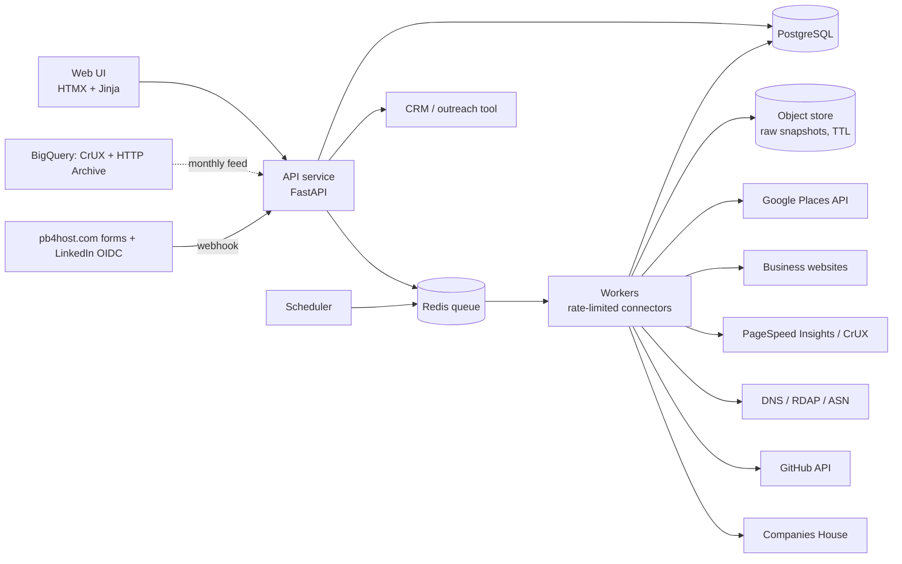
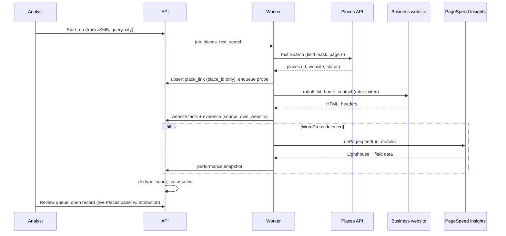

# PB4HOST customer intelligence app ("Prospector") — implementation plan
**Prepared 14 October 2026. Status: plan for approval. No code, cloud accounts, API keys or data collection exist yet.**

## 1. Summary
PB4HOST wants an application that collects customer details from publicly available platforms such as LinkedIn and Google Business Profile. This plan proposes **Prospector**: an organisation-first lead discovery and enrichment service that

- **discovers** businesses and agencies through Google's Places API, public web-performance datasets, and PB4HOST's own inbound channels;
- **enriches** each organisation from its *own* website — contact details, WordPress/WooCommerce fingerprint, page speed, visible errors, hosting provider;
- **scores** fit against PB4HOST's three offers (WordPress repair, speed optimization, agency white-label support);
- keeps **provenance, consent and suppression** records for every stored field; and
- **exports** qualified organisations to whichever CRM or outreach tool PB4HOST chooses. It does not send outreach itself.

The platforms named in the request behave very differently once you read their terms, so the plan is explicit about what each one permits:

| Platform | What is actually available | How Prospector uses it |
|---|---|---|
| **Google Business Profile** | The Business Profile API only manages listings you own. Third-party discovery goes through the **Places API (New)**, whose terms allow storing the `place_id` indefinitely, coordinates for 30 days, and nothing else — other fields must be requested live and shown with Google attribution. | Discovery and linking only. Prospector stores the `place_id`, follows the business's website, and records contact details from that website with provenance. |
| **LinkedIn** | The open API returns only the signed-in member's own data (OpenID Connect: name, email, picture). There is no search or third-party profile endpoint. Scraping, crawlers and unapproved extensions are prohibited by User Agreement §8.2 (effective 3 November 2025); LinkedIn litigates against scraping vendors (Proxycurl shut down in 2025 after a lawsuit). | Four compliant routes only: Sign In with LinkedIn on PB4HOST's own forms; the owner's own connections export; manual research with notice tracking; optionally LinkedIn's gated partner programs or a licensed data vendor later. **No automated LinkedIn collection.** |
| **Everything else "open"** | Company websites, PageSpeed Insights, Chrome UX Report and HTTP Archive datasets, DNS/ASN, UK Companies House, GitHub, Indian registries (manual), first-party forms and customer exports. | These are the main engines. For PB4HOST's services the most valuable signal is not a person's profile; it is "this business runs a slow or broken WordPress site", which public data answers well. |

**Headline plan:** 1-week decision and legal gate → 1-week pipeline spike on ~100 real businesses → MVP by the end of week 5 → inbound/consent/CRM integration by week 8 → hardening by week 10. One full-stack developer plus 3–4 owner hours a week. Running cost at pilot volume sits mostly inside free tiers plus a small VPS.

Everything below is a proposal for approval; owner decisions are collected in §15.

## 2. Goals, users and non-goals
### Goals (measurable at launch + 60 days)
1. Produce ≥ 200 qualified organisations per month per target market with a documented reason for qualification and a public evidence link for every signal.
2. ≥ 97% precision on "runs WordPress" detection and < 5% false positives on "site is broken" after the confirmation re-check, measured on a labelled golden set of 50 sites.
3. 100% of stored fields carry source, URL and timestamp; 100% of person records carry a lawful basis and notice status.
4. Suppression and erasure requests resolved by a single workflow within 7 days, with an audit trail.
5. Pilot infrastructure and API cost ≤ ₹5,000/month at 2,000 discovered organisations/month (verify against current Google pricing during Phase 0).

### Users
- **Owner/founder:** sets markets and ideal customer profile (ICP), approves sources, reviews the queue, decides outreach.
- **Analyst (sales/ops):** runs discovery, verifies records, adds manual research, exports to CRM.
- **Engineer (PB4HOST):** operates the VPS deployment, rotates keys, maintains fingerprints and connectors.

### Non-goals — what Prospector will not do
- No LinkedIn scraping, browser extensions, session automation, fake accounts, or "LinkedIn scraper API" vendors.
- No sending of email, SMS, WhatsApp or calls. Outreach happens in a tool with identity, unsubscribe and consent controls, consistent with the guardrails in `free-promotion-kit.md` (no scraped numbers, no bulk unsolicited broadcasts).
- No purchased scraped lists, no email-pattern guessing (`firstname@domain`), no storing Google reviews, review authors or photos, no personal data of website visitors.
- No vulnerability scanning of third-party sites (no WPScan-style enumeration, no login or admin probing). Detection is passive: only what a normal browser fetch of public pages reveals.
- Not a CRM. It feeds one.

## 3. Use cases
| ID | Use case | Primary sources | Output |
|---|---|---|---|
| UC1 | **Territory discovery (SMB track):** "Find businesses in Bengaluru/Mangalore/Mumbai with slow or broken WordPress sites." | Places API → own website → PageSpeed Insights, CrUX | Scored organisation list with evidence |
| UC2 | **Agency discovery (white-label track):** "Find web design/marketing agencies that build on WordPress." | Places API (agency categories), GitHub organisations, HTTP Archive technology data, manual directory research | Agency list with portfolio/tech signals |
| UC3 | **Existing-customer enrichment:** detect upsell and retention signals on current customers' domains (slow checkout, expired TLS, outdated stack). | WooCommerce/invoice export → own website → PSI | Alerts and account notes; strongest legal footing (existing relationship) |
| UC4 | **Inbound lead enrichment:** a visitor requests a speed evaluation or agency partnership; the app enriches the submitted domain before the first reply. | Website form webhook, Sign In with LinkedIn (OIDC), own website, PSI | Enriched lead within minutes, consent recorded |
| UC5 | **Manual research capture:** an analyst reads a public LinkedIn company page, directory or job post and records organisation facts and, if justified, one named contact. | Human entry with reference URL | Record flagged `source=manual_research` with notice tracking |
| UC6 | **Rights and suppression:** a person or business asks not to be contacted or to be erased. | Any | Suppression entry, erasure/anonymisation, audit log |

## 4. Source assessment — what each platform actually permits
Decisions: **USE** (build a connector), **MANUAL** (human capture form only), **DEFER** (revisit later), **AVOID** (not used). Costs and terms are as understood on 14 October 2026; re-verify at execution.

| # | Source | What it yields | Access route | Cost | Rules that constrain use | Decision | Phase |
|---|---|---|---|---|---|---|---|
| 1 | Google Business Profile listings via **Places API (New)** (Text Search, Nearby Search, Place Details) | Name, address, coordinates, phone, website, place types, rating/count, business status, hours | Official API, API key, Google Cloud project with billing | Per-SKU free monthly caps since March 2025 (reported as 10k Essentials / 5k Pro / 1k Enterprise calls), then per-1,000 pricing; contact fields such as website and phone fall in the higher SKUs | Only `place_id` may be stored indefinitely; lat/lng ≤ 30 days; other content requested live and shown with Google attribution; no building a business-listings or telemarketing database from Maps content; no scraping Maps | USE for discovery and linking only | 1 |
| 2 | **Google Business Profile API** | Manage PB4HOST's own listing | OAuth, Google approval | Free | Own locations only | Not a prospecting source; optional for PB4HOST's own profile if eligible | — |
| 3 | **LinkedIn — Sign In with LinkedIn (OpenID Connect)** | `name`, `given_name`, `family_name`, `picture`, `locale`, `email` (if granted) of the person signing in | OIDC on PB4HOST's own forms (`openid profile email`) | Free | Only the consenting member's own data, used for the stated purpose | USE on inbound forms | 2 |
| 4 | **LinkedIn — owner's own data export** (Connections CSV) | First/last name, company, position, connected-on date, email only where the connection allows it | Owner downloads from LinkedIn settings; CSV import | Free | It is the owner's personal network; keep it to the owner's seat, relationship-based contact only, no bulk messaging | USE (owner seat only) | 2 |
| 5 | **LinkedIn — manual research** | Organisation facts (name, website, size band, HQ, services); at most one named contact with role when justified | Human reads public pages and types into the capture form; profile URL stored as reference | Labour | No extensions or automation; person records require lawful basis and notice tracking (§5) | MANUAL | 1 |
| 6 | **LinkedIn — partner programs** (Marketing Developer Platform organisation lookup, Sales Navigator CRM sync, Lead Sync) | Organisation data; Sales Navigator leads into supported CRMs; ad-form leads | Application and approval; paid products | Paid | Gated; member-data retention limits; approved CRMs only | DEFER | 3+ |
| 7 | LinkedIn scrapers, extensions, automation tools, "LinkedIn data APIs" | — | — | — | Prohibited by User Agreement §8.2; account restriction; vendor litigation precedent | AVOID | — |
| 8 | **The business's own website** | Contact details, address, GSTIN/CIN where displayed, social links, CMS/plugin fingerprint, visible error states, TLS, redirects, hosting headers | Prospector crawler: robots.txt-aware, identified user agent, ≤ 1 request/s per host | Hosting only | robots.txt and rate limits; store extracted facts, not page copies beyond a short TTL; privacy law for any person data on team pages (not extracted automatically) | USE — primary enrichment | 1 |
| 9 | **Google PageSpeed Insights API** | Lighthouse lab metrics plus CrUX field data for a URL | API key | Free; default quota 25,000 queries/day with a per-100-second rate limit (check project quotas) | Google APIs terms | USE | 1 |
| 10 | **Chrome UX Report** (CrUX API; CrUX BigQuery `materialized.country_summary`, `device_summary`) | Origin-level p75 LCP/INP/CLS, by device and country, monthly | API key / BigQuery | Free; BigQuery free tier (1 TB processed/month) | Only origins with sufficient Chrome traffic; many small businesses are absent | USE for qualification and a discovery feed | 2 |
| 11 | **HTTP Archive BigQuery** | Technology detections (Wappalyzer fork) and Lighthouse data for CrUX origins, monthly | BigQuery | Free tier; use filtered/materialised tables to control bytes scanned | Public dataset; coverage limited to CrUX origins | USE — join with CrUX by country for "WordPress origins in IN with poor LCP" | 2 |
| 12 | **DNS / RDAP / IP→ASN** | Mail provider (MX), hosting IP and ASN/provider, reverse DNS, registrar and domain age (registrant usually redacted) | `dnspython`, RDAP, Team Cymru / MaxMind GeoLite2-ASN / ipinfo free tier | Free or freemium | Registry rate limits; no bulk WHOIS harvesting | USE | 1 |
| 13 | **UK Companies House API** | Company search, profile, officers, filings | Free API key | Free | Companies House terms; officer data is personal data | USE if the UK is a target market | 2 |
| 14 | **India: MCA company master data, GST portal, Udyam** | Legal/trade name, status, state, registration dates | Manual public search (captcha) or licensed APIs via GST Suvidha Providers | Free manual; paid API | No captcha bypass or automation of the portals | MANUAL verification field; licensed API optional | 2 |
| 15 | **OpenCorporates** | Global registry data | API key; free only for open-data/public-benefit use, commercial licence otherwise | Paid for commercial use | Licence terms | DEFER unless multi-country | 3 |
| 16 | **GitHub API** | Organisations publishing WordPress themes/plugins, their location and website | REST/GraphQL with token | Free; search rate limits | Acceptable Use Policies: no spam, no using information for unsolicited email or selling personal data | USE for agency identification, organisation-level only | 2 |
| 17 | Facebook / Instagram Pages | Page info | Graph API Page Public Content Access requires app review; scraping prohibited | — | Meta Platform Terms | MANUAL reference URL only | — |
| 18 | Agency directories (Clutch, GoodFirms, DesignRush), WordPress.org showcase, job and freelance boards | Agency lists; intent signals ("need WordPress fix") | Manual browsing; check for official APIs case by case | — | Terms generally prohibit scraping | MANUAL | — |
| 19 | **PB4HOST first-party data** — website forms, WhatsApp conversations, WooCommerce customers, tickets | Consented leads; existing customers | Webhook from the WordPress form plugin; CSV export | Free | PB4HOST's privacy notice must describe enrichment and marketing purposes | USE — highest quality | 1 (CSV), 2 (webhook) |
| 20 | Licensed B2B data vendors (Apollo, Lusha, Cognism, ZoomInfo, People Data Labs, HubSpot Breeze) | Contacts and firmographics | Paid API | Paid | Vendor compliance claims do not transfer; PB4HOST remains the Data Fiduciary/controller and must do DPDP/GDPR due diligence | OPTIONAL — owner decision | 3 |

### 4.1 LinkedIn routes in detail
1. **Sign In with LinkedIn (OIDC)** on the "request a speed evaluation" and "agency partner" forms. Scopes `openid profile email`; data from `GET https://api.linkedin.com/v2/userinfo`. Store `sub`, name, email, picture URL only; record the consent text version and timestamp. This removes typing friction for the prospect and gives a verified identity.
2. **Owner's connections export.** The owner downloads their own LinkedIn data archive and imports `Connections.csv` (First Name, Last Name, URL, Email Address, Company, Position, Connected On). Prospector matches companies to organisations, enriches the company website, and surfaces "people you already know at qualified organisations". Contact is personal and one-to-one, which matches the promotion kit's "contact peers you know" guidance.
3. **Manual research form.** Fields: organisation, website, LinkedIn company URL (reference), employee band, services, HQ, notes; optional person: name, role, profile URL, lawful basis, notice status. The form rejects bulk paste of more than one person per submission by design; this is deliberately slow.
4. **Partner programs** remain a later option if PB4HOST obtains approval or adopts a CRM with an official Sales Navigator integration.

### 4.2 Google Places — how the storage rules shape the design
- **Discovery run:** Text Search with a field mask limited to `places.id`, `places.displayName`, `places.businessStatus`, `places.websiteUri`, `places.types`, `places.location`, paginated. Requesting `websiteUri` directly from Text Search avoids a second Place Details call per business.
- **Persist only** `place_id`, `lat/lng` with a 30-day expiry, and the fact that a run found it. The website URL is immediately resolved by the crawler, and the **canonical URL observed on the business's own site** is what Prospector stores, with provenance `own_website`.
- **Display:** anything shown from Places (name, rating, status) is fetched live when an analyst opens the record and rendered with the "Google" attribution the terms require; it is never cached in the database or exports. Business name, phone and address in Prospector come from the business's own site, registries or manual research.
- **Not permitted and not built:** bulk export of Places content, storing ratings/reviews, using Places to build a telemarketing list. This is a conservative reading of the Service Specific Terms; counsel confirms it in Phase 0 and Google's terms are re-read every quarter (they changed in 2024 and 2025).

### 4.3 Public web datasets as a discovery feed
A monthly BigQuery query joins CrUX `materialized.country_summary` (origins with poor p75 LCP/INP on phone, `country_code = 'IN'` or other targets) with HTTP Archive technology detections where `WordPress` is present. Output: origins already known to be slow and on WordPress. Coverage is limited to sites popular enough to be in CrUX, so this complements rather than replaces Places. The resulting origins enter the same enrichment pipeline as everything else.

### 4.4 The business's own website — primary enrichment
Pages fetched: home, `/contact*`, `/about*`, privacy/terms/imprint, `sitemap.xml` and `robots.txt`, plus the first-party assets the homepage references. Extracted:

- **Contact facts:** generic business emails, phone numbers (normalised to E.164), postal address, GSTIN/CIN patterns in footers, social links (stored as URLs only).
- **Stack fingerprint:** WordPress markers (`/wp-content/`, `/wp-includes/`, `meta generator`, `api.w.org` link), WooCommerce markers (`woocommerce` body class, plugin path, `wc-ajax`), theme name from the theme path, page builders (Elementor, WPBakery, Divi, Avada), caching layers (WP Rocket signature, LiteSpeed, `x-cache`, host-specific headers), CDN/WAF (Cloudflare, Sucuri), server header. An optional, default-off config enables two extra public fetches (`/readme.html`, `/wp-json/`) for version context; no other paths are probed.
- **Health:** HTTP status and redirect chain, visible error strings ("Error establishing a database connection", "There has been a critical error on this website", PHP `Fatal error`/`Warning` output, maintenance notice), parked-domain templates, TLS validity and expiry, mixed content on the homepage. Any "broken" state is re-checked twice over 24 hours before it counts.
- **Hosting:** A record → ASN and provider class (shared host, managed WordPress host, cloud, unknown); MX → mail provider.

Crawler conduct: user agent `PB4HOSTProspector/1.0 (+https://www.pb4host.com/prospector; prospector@pb4host.com)` with the landing page explaining purpose and opt-out; obey robots.txt and `429`/`403`; one request per second per host; 30-day cache; no JavaScript rendering unless a site returns nothing without it (Playwright behind a flag); no proxies, no login, no captcha solving.

## 5. Compliance and ethics guardrails (design requirements)
Legal context, not legal advice — counsel signs off at the Phase 0 gate:

- **India:** Digital Personal Data Protection Act 2023 and the DPDP Rules 2025 (published 14 November 2025; Data Fiduciary obligations apply in substance around May 2027 under the phased schedule, with consent-manager provisions around November 2026 — confirm current dates). Consent is the primary basis; notices, rights handling, breach notification and retention rules follow. The Act's exemption for personal data a person has themselves made public is narrow and untested; treat it as a mitigating factor, not a design basis. Business-entity data (company name, generic phone/email, GSTIN) is not personal data, which is why Prospector is organisation-first.
- **EU/UK prospects:** GDPR/UK GDPR — document a legitimate-interests assessment for B2B prospecting, give an Article 14-style notice at first contact, honour objections; PECR/ePrivacy for electronic marketing (sole traders are treated as individuals in the UK).
- **US prospects:** CAN-SPAM for email (identity, physical address, working opt-out).
- **Calls and SMS to Indian numbers:** TRAI's TCCCPR 2018 (amended February 2025; a third amendment was in consultation in March 2026) requires DLT registration, registered headers/templates, DND scrubbing and verifiable consent, and bans telemarketing from ordinary 10-digit numbers. Prospector does not support calling or SMS lists; any such channel is a separate, registered setup.
- **Platform terms:** Google Maps Platform (attribution, no caching beyond `place_id`/coordinates, no listings database), LinkedIn (no scraping/automation), GitHub AUP (no unsolicited email from collected information), robots.txt and site terms for crawled websites.

Requirements the code must enforce (each has a test in §12):

| ID | Rule |
|---|---|
| R1 | Every stored field has provenance: source, source URL, fetched-at, expires-at, confidence. |
| R2 | Organisation-first. A `person` row cannot be saved without `lawful_basis` ∈ {consent, contract, legitimate_interest(LIA reference), manual_research} and a `notice_status`. Automated connectors never create `person` rows. |
| R3 | Each connector declares a **storage policy** that is applied before persistence. The Places policy drops everything except `place_id`, coordinates (expiry 30 days) and run metadata. |
| R4 | Crawler obeys robots.txt, rate limits and `429`/`403`; identified user agent; no authentication, captcha or proxy use; passive fetches only. |
| R5 | Retention jobs: raw HTML snapshots 30 days; coordinates 30 days; performance snapshots 12 months; organisations with no engagement 12 months → anonymised; persons without consent and no engagement 6 months → deleted; suppression entries kept indefinitely as salted hashes. Periods are configuration, defaults as stated. |
| R6 | Suppression and rights: one workflow finds, exports and erases by email, phone, domain or `place_id`; exports exclude suppressed entities; status changes are audited. |
| R7 | Exports carry the source and notice text needed by the outreach tool (why the business is being contacted, how to opt out). No export of persons with `notice_status = objected` or `do_not_contact`. |
| R8 | Security baseline: TLS, encrypted disk or `pgcrypto` for person fields, role-based access (owner, analyst, viewer), 2FA, secrets outside Git, no personal data in logs, nightly encrypted backups with a monthly restore drill. |
| R9 | Audit log of every view and export of person data and every status change. |
| R10 | Kill switch per connector; a connector cannot run while its `terms_reviewed_at` is older than 90 days. |
| R11 | Daily spend and call caps per paid API, enforced in the worker before the request is made. |

## 6. Product scope by release
**MVP (end of Phase 1):** discovery runs (Places), CSV import (customers, manual lists), manual research form, website enrichment, DNS/ASN, PageSpeed Insights, dedupe v1, scoring v1, review list with filters, organisation detail with evidence links and live Places attribution panel, suppression, CSV export, audit log, retention jobs, docker-compose deployment.

**Release 2:** website form webhook, Sign In with LinkedIn, LinkedIn connections import, CrUX API, CrUX + HTTP Archive discovery feed, GitHub agency discovery, Companies House (if UK), CRM sync (one of HubSpot free, EspoCRM, Twenty — owner decision), rights-request workflow with notice tracking, scheduled re-checks for tracked organisations.

**Release 3:** scoring v2 calibrated on outcomes, funnel and cost dashboards, optional licensed-vendor connector behind a feature flag, hardening and handover.

## 7. Architecture


Principles:
- **Connectors are plugins** with one interface (Appendix B): `discover()`, `enrich()`, a declared storage policy, rate limit, cost per call and terms URL. Adding a source never touches core code.
- **Evidence, not opinions.** Connectors emit `Evidence` items; scoring reads evidence; the UI shows the evidence URL next to every signal.
- **Queue everything external.** All third-party calls run in workers with per-host and per-API token buckets, retries with backoff, idempotency keys and daily caps.
- **Small deployment.** Docker Compose on a PB4HOST VPS: `api`, `worker`, `scheduler`, `postgres`, `redis`, `caddy` (TLS). No Kubernetes. Object store is a local volume with TTL cleanup (MinIO or S3 if it grows).

### Discovery sequence


### Technology choices
| Layer | Recommendation | Why | Alternative |
|---|---|---|---|
| Language/runtime | Python 3.12 | Best libraries for crawling, record linkage, phone/address normalisation | PHP 8 / Laravel if the team prefers PHP; same design, expect +1–2 weeks for data tooling |
| API | FastAPI + Pydantic v2 + SQLAlchemy 2 + Alembic | Typed, fast to build, OpenAPI for free | Django + DRF |
| Workers | Redis + RQ (or `arq`) with `tenacity` retries | Simple, inspectable; enough for thousands of jobs/day | Celery; Temporal if workflows grow |
| Database | PostgreSQL 16 (+ `pg_trgm`, `pgcrypto`) | Relational integrity, JSONB for evidence payloads, trigram search | — |
| HTTP/parsing | `httpx`, `selectolax` or BeautifulSoup, `protego`/`urllib.robotparser` for robots.txt | Lightweight, async-friendly | Playwright only behind a flag |
| Normalisation | `phonenumbers`, `email-validator`, `dnspython`, `tldextract`, `rapidfuzz`; `libpostal` optional | Mature, permissive licences | — |
| Record linkage | Deterministic keys first; `splink` (DuckDB backend) when fuzzy matching is needed | Explainable, scales | `dedupe` |
| Fingerprints | Own WordPress/WooCommerce detector; `webappanalyzer` fingerprints (GPL-3.0, compatible with this repository's licence) for broader tech | Narrow, testable, fewer false positives | WhatWeb (Ruby) |
| UI | HTMX + Jinja templates + Tailwind | Minimal front-end tooling, fast CRUD/review screens | Next.js if a richer UI is needed later |
| CRM target | HubSpot free, EspoCRM (AGPL) or Twenty (open source) | Owner decision (§15) | Google Sheets export as interim |
| Observability | `structlog` JSON logs, Prometheus metrics endpoint, Uptime check, optional Sentry | Enough for one VPS | — |
| Quality | `pytest`, `vcrpy` cassettes, `ruff`, `mypy`, pre-commit | Standard | — |

## 8. Data model
| Entity | Purpose | Key fields |
|---|---|---|
| `organization` | The unit of scoring and export | id, display_name, legal_name, trade_name, domain (normalised), website_url (canonical), country, region, city, address_text, phones_e164[], generic_emails[], track (smb/agency/unknown), registry_ids JSONB (gstin, cin, company_number), status (new/reviewing/qualified/exported/contacted/customer/disqualified/suppressed), score_total, score_breakdown JSONB, scoring_version, owner_user_id, last_engaged_at, timestamps |
| `place_link` | Places linkage under the storage policy | organization_id, provider, place_id, lat, lng, coords_expires_at, first_seen_run_id, last_seen_at |
| `website` | Technical facts about the primary site | id, organization_id, url, final_url, http_status, cms, cms_version, is_woocommerce, theme, page_builder, caching_layer, cdn, server_header, host_ip, host_asn, host_provider, host_class, mail_provider, tls_expires_at, error_state, error_confirmed_at, robots_allowed, last_probed_at |
| `performance_snapshot` | Lab and field metrics over time | id, website_id, strategy (mobile/desktop), lh_performance, lcp_ms, inp_ms, cls, ttfb_ms, field_lcp_p75, field_inp_p75, field_cls_p75, field_available, source (psi/crux_api/crux_bq), fetched_at |
| `evidence` | Provenance for every fact (R1) | id, organization_id, entity_type, entity_id, field, value, source, source_url, confidence, fetched_at, expires_at |
| `person` | Named contacts, consent-bound (R2) | id, organization_id, full_name, role_title, email, phone_e164, linkedin_url (reference only), source, lawful_basis, consent_id, notice_status (not_required/pending/sent/objected), do_not_contact, created_by, timestamps |
| `consent_record` | Proof of consent or notice | id, person_id, purpose, text_version, captured_via (form/oidc/import/manual), captured_at, ip_hash, proof_ref, withdrawn_at |
| `suppression` | Do-not-contact list (R6) | id, kind (domain/email/phone/place_id), value_hash, reason, requested_by, created_at |
| `discovery_run` | One search execution | id, track, provider, query, location, radius_m, pages_fetched, candidates_found, calls_made, cost_estimate, started_by, started_at, finished_at |
| `import_batch` | CSV imports | id, kind (customers/linkedin_connections/manual), filename, row_count, column_mapping JSONB, imported_by, created_at |
| `job` | Queue bookkeeping | id, type, payload JSONB, idempotency_key, status, attempts, last_error, run_after, started_at, finished_at |
| `activity_log` | Audit (R9) | id, actor_id, action, entity_type, entity_id, metadata JSONB, at |
| `scoring_rule_version` | Reproducible scores | id, yaml, checksum, activated_at |
| `connector_state` | Terms review and kill switch (R10) | connector, enabled, terms_url, terms_reviewed_at, daily_cap, calls_today, last_error |
| `user` | Access control | id, email, name, role (owner/analyst/viewer), totp_enabled |

Dedupe keys, in order: normalised domain → `place_id` → registry id → phone E.164 → fuzzy (`rapidfuzz` token-set ratio ≥ 92 on name + same city). Merges keep all evidence and record the merge in the audit log.

## 9. Connector specifications (Phase 1 and 2)
| Connector | Input → output | Calls and quotas | Storage policy and TTL | Failure handling |
|---|---|---|---|---|
| `google_places` | Query + location (+ radius or region) → candidate places | Text Search (New) with a minimal field mask, ≤ 20 results/page, follow `nextPageToken`; Nearby Search for radius runs; Place Details only on demand for the live attribution panel | Persist `place_id`, lat/lng (30 days), run metadata; everything else discarded after enqueuing the website probe | Daily cap (default 200 pages), stop run on quota or billing errors, exponential backoff |
| `website_probe` | URL → website facts, contact facts, health state, evidence | ≤ 6 page fetches per site; 1 req/s per host; 10 s timeout; 2 MB cap per page | Facts and evidence persisted; raw HTML snapshot 30 days; re-probe interval 30 days or on demand | Respect robots and `429`; classify DNS/TLS/HTTP failures; confirmation re-check for error states after 1 h and 24 h |
| `dns_asn` | Domain → MX provider, A/AAAA, ASN, provider, class, reverse DNS | Local resolver with caching; Team Cymru DNS lookups or GeoLite2-ASN database | Persist facts; refresh 30 days | Treat NXDOMAIN as `dns_fail`; never block on RDAP |
| `pagespeed` | URL + strategy → Lighthouse and field metrics | 1–3 runs per URL (median of lab metrics); mobile first, desktop optional; within the 25k/day project quota and per-100-s rate | Persist snapshot; keep raw JSON 30 days | Retry on 5xx; mark `field_available=false` when CrUX absent |
| `csv_import` | CSV + mapping → organisations/persons | Local | Persons from imports require a lawful basis chosen at import time; rows without one import as organisations only | Row-level error report; nothing partially imported without a batch id |
| `manual_capture` | Form → organisation/person + reference URLs | Local | Person requires lawful basis and notice status | — |
| `inbound_webhook` (R2) | Form payload (signed) → organisation + person + consent record → enqueue enrichment | HMAC-verified endpoint | Consent text version and timestamp stored | Replay protection via idempotency key |
| `linkedin_oidc` (R2) | Authorization code → `userinfo` → person + consent | OIDC standard flow; scopes `openid profile email` | Store `sub`, name, email, picture URL; token discarded after use | Standard OAuth error handling |
| `crux` (R2) | Origin → p75 field metrics | CrUX API; monthly BigQuery feed | Snapshot source `crux_api`/`crux_bq` | Absent data is not an error |
| `httparchive_feed` (R2) | Country + month → WordPress origins with poor CWV | One scheduled BigQuery query per month against materialised tables; budget alert at 100 GB | Origins become candidates with `source=httparchive_crux` | Fail closed on cost estimate above budget |
| `github_orgs` (R2) | Topic/location query → organisations with WordPress repos | REST search within authenticated limits | Organisation name, website, location only; no user emails | Backoff on secondary rate limits |
| `companies_house` (R2) | Name/number → company profile | Free API key | Company facts; officers only on explicit analyst request with lawful basis | — |
| `crm_sync` (R2) | Qualified organisations → CRM objects | Chosen CRM's API | Push only non-suppressed, notice-ready records; write back `contacted`/`customer` | Idempotent upsert on domain |

## 10. Lead scoring v1 (rule-based, explainable)
Scores are computed per **organisation/website**, never per person, from evidence with public URLs. Rules live in versioned YAML; the UI shows the breakdown.

| Signal | Points (SMB track) | Points (agency track) | Evidence |
|---|---|---|---|
| Website runs WordPress | +30 | +15 | fingerprint markers |
| WooCommerce present | +10 | +5 | plugin path / body class |
| Confirmed error state (5xx, DB error, fatal error, maintenance > 24 h) | +25 | +10 | re-check records |
| Lighthouse mobile performance < 50 / 50–74 | +20 / +10 | +10 / +5 | PSI JSON |
| CrUX field p75: LCP > 4 s or INP > 500 ms | +15 | +10 | CrUX |
| Exposed WordPress version two or more majors behind | +10 | +5 | generator tag (if present) |
| Heavy page builder without a detected caching layer | +10 | +5 | fingerprint |
| TLS expiring within 30 days or invalid | +10 | +5 | TLS check |
| Shared-hosting ASN class | +5 | 0 | ASN |
| Agency signals: "we build websites", portfolio pages, WordPress repos on GitHub, agency place types | 0 | +25 | own site / GitHub / Places types |
| Managed WordPress host detected (WP Engine, Kinsta, etc.) | −10 (hosting offer) | 0 | headers |
| Not WordPress | disqualify for WP offers; keep for VPS/Linux if a server stack is visible | — | — |
| Suppressed or `do_not_contact` | excluded | excluded | suppression |

Thresholds: ≥ 70 hot, 40–69 warm, < 40 cold. Phase 3 recalibrates weights from outcomes (replied, qualified call, won), keeping the model rule-based unless volume justifies more.

```yaml
# scoring/v1.yaml (excerpt)
version: 1
tracks:
  smb:
    rules:
      - id: wp_detected
        when: website.cms == "wordpress"
        points: 30
      - id: broken_confirmed
        when: website.error_state != "none" and website.error_confirmed_at is not null
        points: 25
      - id: slow_mobile
        when: perf.mobile.lh_performance < 50
        points: 20
thresholds: { hot: 70, warm: 40 }
```

## 11. Delivery plan
Assumes one full-stack developer at full time, the owner for decisions and review (3–4 h/week), and counsel at two gates. Durations are estimates.

### Phase 0 — Decide and clear (Week 1)
- Confirm markets, ICP, tracks, CRM target, budget cap and the decisions in §15.
- Counsel reviews the source register (`prospecting-source-register.csv`), the storage policies, outreach channel plan, privacy-notice updates for pb4host.com, and the DPDP/GDPR basis per use case.
- Create accounts: Google Cloud project (Places API (New), PageSpeed Insights API, BigQuery; budget alerts), LinkedIn developer app (OIDC), GitHub token, Companies House key if needed.
- Write the ICP and scoring rubric v1 with the owner.
- **Gate:** signed-off source register and storage policies; approved budget; go/no-go.

### Phase 1 — Spike, then MVP (Weeks 2–5)
- **Week 2 spike:** a CLI script runs Places → website probe → PSI on ~100 businesses in two target cities (e.g., Mangalore and Bengaluru) and on existing customer domains. Owner reviews a spreadsheet of results. Measures: detection precision, share of WordPress sites, share with poor performance, API calls used, cost. **Gate:** enough qualified organisations to justify the build (target ≥ 15% of discovered businesses scoring warm or hot) — otherwise adjust queries/categories before building UI.
- **Weeks 3–5 MVP:** data model and migrations; API; workers and scheduler; connectors `google_places`, `website_probe`, `dns_asn`, `pagespeed`, `csv_import`, `manual_capture`; dedupe v1; scoring v1; UI (discovery run, review queue with filters, organisation detail with evidence and live Places attribution panel, suppression, CSV export, imports); audit log; retention jobs; docker-compose deployment with TLS; runbook.
- **Acceptance:** a "web design agency in Bengaluru" run yields ≥ 50 enriched organisations with evidence links inside the daily caps; the golden-set precision targets in §2 are met; R1–R6, R8–R11 tests pass; a restore from backup works on a clean VM.

### Phase 2 — Inbound, consent and more sources (Weeks 6–8)
- Website form webhook with consent capture; Sign In with LinkedIn on the evaluation and agency forms; LinkedIn connections import; CrUX API; monthly CrUX + HTTP Archive discovery feed; GitHub agency discovery; Companies House (if the UK is in scope); CRM sync; rights-request workflow and notice tracking; scheduled re-checks (weekly, light) for tracked organisations and customers.
- Update the pb4host.com privacy notice and publish the crawler page.
- **Gate (counsel, second review):** notice templates and export format approved before the first outreach batch leaves the CRM.
- **Acceptance:** an inbound test submission is enriched and visible in the CRM within 10 minutes; an erasure request removes the person and anonymises the organisation history within one workflow; R7 tests pass.

### Phase 3 — Learn and harden (Weeks 9–10)
- Scoring v2 from recorded outcomes; funnel, quota and cost dashboards; security review (dependency audit, headers, access review); backup/restore drill; handover documentation; monthly compliance checklist (terms re-read, retention job report, suppression audit, API spend).
- Optional: licensed-vendor connector behind a flag if the owner decides to buy data.

### Ongoing
Quarterly: re-read Google, LinkedIn and GitHub terms (R10 enforces 90 days); refresh fingerprints; review scoring weights; purge report to the owner.

## 12. Testing and quality
- **Unit:** fingerprint and contact extractors against fixture HTML (WordPress/WooCommerce/Elementor/Divi/non-WP/parked/broken); phone, email and domain normalisation; scoring rules against synthetic evidence.
- **Contract:** each connector replayed with recorded responses (`vcrpy`), including quota, `429` and malformed payload cases.
- **Compliance suite (maps to §5):** R1 — persisting a fact without provenance fails; R2 — automated connectors cannot create `person` rows, persons without lawful basis are rejected; R3 — the Places storage policy strips disallowed fields (assert on the serialised row); R4 — robots-disallowed paths are never fetched, rate limiter enforced; R5 — retention job removes expired snapshots/coordinates; R6/R7 — suppressed and objected records never appear in exports; R10 — a connector with stale `terms_reviewed_at` refuses to run; R11 — daily caps stop calls.
- **Golden set:** 50 labelled sites (WordPress yes/no, broken yes/no, host class) re-run weekly in CI against live sites; alert on precision drop.
- **Integration:** docker-compose end-to-end run against a mock Places server and a local sample site.
- **UAT:** owner runs three real discovery queries and one import, then signs off on the evidence quality.

## 13. Operations, security and cost
- **Hosting:** one PB4HOST VPS (4 vCPU, 8 GB) runs everything; Caddy for TLS; admin UI behind 2FA and, optionally, an IP allow-list or VPN.
- **Secrets:** `.env` on the server or SOPS-encrypted files; never in Git (this repository's README already states that rule).
- **Backups:** nightly encrypted `pg_dump` to off-box storage; 30-day rotation; monthly restore drill.
- **Monitoring:** health endpoint, queue depth, connector error rate, API spend vs cap, retention job success; uptime check; alerts to the owner.
- **Indicative monthly cost at pilot volume (~2,000 organisations/month):**

| Item | Estimate | Note |
|---|---|---|
| Google Places | ₹0–3,000 | ~100–200 Text Search pages/month likely within the per-SKU free cap; verify the SKU your field mask triggers and set a budget alert |
| PageSpeed Insights, CrUX API | ₹0 | Free quotas |
| BigQuery (monthly feed) | ₹0–500 | Stay inside the 1 TB free tier with materialised tables |
| VPS, backups, domain | ₹1,500–3,000 | Existing PB4HOST infrastructure may absorb this |
| LinkedIn OIDC, GitHub, Companies House | ₹0 | Free |
| Optional: licensed data vendor | ₹5,000–40,000+ | Only if decided in §15 |
| Developer time | ~9–10 weeks | One full-stack developer |

## 14. Risks and mitigations
| Risk | Impact | Mitigation |
|---|---|---|
| Platform terms change (Google, LinkedIn, GitHub) | Connector becomes non-compliant | R10 review clock and kill switch; connectors isolated; quarterly review |
| Places interpretation challenged | Must purge derived data | Only `place_id` persisted; all contact facts sourced from the business's own site with provenance; counsel sign-off recorded |
| Legal timeline (DPDP Rules phases, GDPR exposure) | Obligations before launch of outreach | Build to the strict standard now; notices and rights workflow in Phase 2 before the first batch |
| Low CrUX/HTTP Archive coverage of small businesses | Weak discovery feed | Treat as supplementary; Places and first-party remain primary |
| Detection false positives (CDN/WAF masks WordPress; transient outages) | Wrong outreach, reputational harm | Golden set in CI; double confirmation for error states; "unknown" is a valid result |
| PageSpeed variance | Noisy scores | Median of runs; prefer field data; score bands, not raw numbers |
| Account or IP blocks from aggressive crawling | Lost access, complaints | Conservative rate limits, identified UA, published opt-out page, robots compliance |
| Scope creep into CRM/outreach | Delays, compliance burden | Non-goals enforced; export and sync only |
| Single developer dependency | Delivery risk | Runbook, tests, simple stack, weekly demos |
| PII breach | Legal and reputational | Minimise persons, encrypt, RBAC, audit, backups, breach plan (DPDP requires prompt notification) |

## 15. Decisions needed from PB4HOST
| # | Decision | Recommended default |
|---|---|---|
| 1 | Target markets for v1 | India first (Karnataka metros), English-speaking international in Phase 2 |
| 2 | Priority track | SMB repair/speed first; agency track in the same MVP because it reuses the pipeline |
| 3 | Include existing customers in enrichment | Yes — strongest legal footing and fastest revenue |
| 4 | Person-level data in v1 | No automated person collection; persons only via inbound consent, manual research, or the owner's own connections |
| 5 | Technology stack | Python/FastAPI as recommended; Laravel acceptable if the team is PHP-first |
| 6 | CRM target | HubSpot free (official LinkedIn Sales Navigator integration available later) or self-hosted EspoCRM/Twenty if data residency matters |
| 7 | Monthly API budget cap | ₹5,000 with alerts at 50/80/100% |
| 8 | Outreach channels | Email with notice and opt-out; one-to-one LinkedIn messages from the owner; WhatsApp only on inbound/opt-in; no SMS/calling lists |
| 9 | Retention periods | Defaults in R5 |
| 10 | Licensed data vendor | Not in v1; revisit after 60 days of outcomes |
| 11 | Where the code lives | Phase 1 code lives in this repository under [`prospector/`](../prospector/) (same GPL-3.0 licence); split into a dedicated `pb4host-prospector` repository later if the app outgrows the documentation repo |
| 12 | Counsel engagement | Two reviews: Phase 0 gate and before the first outreach batch |

## Appendix A — Proposed repository layout
```
pb4host-prospector/
├── apps/
│   ├── api/                 # FastAPI app, routers, auth, templates (HTMX)
│   ├── worker/              # RQ workers, scheduler entrypoints
│   └── cli/                 # spike + ops commands (discover, probe, score, purge)
├── prospector/
│   ├── core/                # models, schemas, scoring, dedupe, policies
│   ├── connectors/          # google_places/, website_probe/, dns_asn/, pagespeed/,
│   │                        # csv_import/, manual_capture/, inbound_webhook/, linkedin_oidc/,
│   │                        # crux/, httparchive_feed/, github_orgs/, companies_house/, crm_sync/
│   └── compliance/          # storage policies, retention jobs, suppression, audit
├── scoring/                 # versioned YAML rule files
├── migrations/              # Alembic
├── tests/
│   ├── unit/  contract/  compliance/  golden/
├── infra/
│   ├── docker-compose.yml   # api, worker, scheduler, postgres, redis, caddy
│   └── Caddyfile
├── docs/
│   ├── runbook.md  source-register.csv  dpia-lite.md  notice-templates.md
└── .env.example             # never commit real secrets or data exports
```

## Appendix B — Connector interface sketch (Python)
```python
from dataclasses import dataclass
from datetime import datetime, timedelta
from typing import Iterable, Protocol

@dataclass(frozen=True)
class Evidence:
    field: str            # e.g. "website.cms", "organization.phone"
    value: str
    source: str           # connector name
    source_url: str       # public URL an analyst can open
    fetched_at: datetime
    expires_at: datetime | None
    confidence: float     # 0..1

@dataclass(frozen=True)
class Candidate:
    external_id: str      # e.g. Google place_id, GitHub org login
    website_hint: str | None
    track: str            # "smb" | "agency" | "unknown"

class StoragePolicy(Protocol):
    def apply(self, raw: dict) -> dict:
        """Return only the fields the source's terms allow us to persist."""

class Connector(Protocol):
    name: str
    terms_url: str
    policy: StoragePolicy
    rate_limit_per_minute: int
    cost_per_call_usd: float
    creates_persons: bool  # must be False for every automated connector (R2)

    def discover(self, query: str, location: str | None) -> Iterable[Candidate]: ...
    def enrich(self, organization_id: int, website_url: str | None) -> Iterable[Evidence]: ...

class PlacesStoragePolicy:
    def apply(self, raw: dict) -> dict:
        return {
            "place_id": raw["id"],
            "lat": raw["location"]["latitude"],
            "lng": raw["location"]["longitude"],
            "coords_expires_at": datetime.utcnow() + timedelta(days=30),
        }
```

## Appendix C — References (verify at execution)
- LinkedIn: Sign In with LinkedIn using OpenID Connect — https://learn.microsoft.com/en-us/linkedin/consumer/integrations/self-serve/sign-in-with-linkedin-v2 ; User Agreement §8.2 "Don'ts" — https://www.linkedin.com/legal/user-agreement ; Prohibited software and extensions — https://www.linkedin.com/help/linkedin/answer/a1341387
- Google: Places API (New) — https://developers.google.com/maps/documentation/places/web-service/op-overview ; Places policies (caching, attribution) — https://developers.google.com/maps/documentation/places/web-service/policies ; Maps Platform Service Specific Terms — https://cloud.google.com/maps-platform/terms/maps-service-terms ; Pricing — https://mapsplatform.google.com/pricing/ ; Business Profile APIs (own listings) — https://developers.google.com/my-business
- PageSpeed Insights API — https://developers.google.com/speed/docs/insights/v5/get-started ; CrUX API — https://developer.chrome.com/docs/crux/api ; CrUX on BigQuery — https://developer.chrome.com/docs/crux/bigquery ; HTTP Archive — https://httparchive.org/faq and https://github.com/HTTPArchive
- Registries: Companies House API — https://developer.company-information.service.gov.uk/ ; OpenCorporates API — https://api.opencorporates.com/ ; MCA — https://www.mca.gov.in/ ; GST search — https://services.gst.gov.in/services/searchtp
- GitHub Acceptable Use Policies (information usage restrictions) — https://docs.github.com/en/site-policy/acceptable-use-policies/github-acceptable-use-policies
- India: DPDP Act 2023 and DPDP Rules 2025 — https://www.meity.gov.in/ ; TRAI TCCCPR 2018 and amendments — https://www.trai.gov.in/
- EU/UK: GDPR Articles 6, 13–14, 21; ICO direct marketing guidance — https://ico.org.uk/
- Libraries: FastAPI, SQLAlchemy, RQ, httpx, `phonenumbers` (Apache-2.0), `rapidfuzz` (MIT), `splink` (MIT), `dedupe` (MIT), `libpostal` (MIT), `webappanalyzer` fingerprints (GPL-3.0), EspoCRM (AGPL-3.0), Twenty CRM

This document changes nothing on the live website and creates no data. Keep credentials, exports and customer data out of Git.
